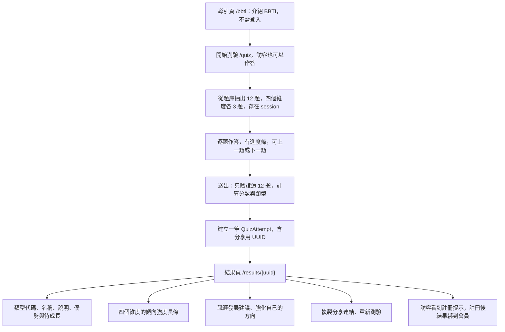

# BBTI 性格測驗 — 功能說明

本文件說明 BBTI 性格測驗目前的實際運作，包含使用者流程、計分、資料表、路由、後台與專屬兔子圖。測驗頁面的版面規格見 `docs/screen-design-spec.md`，後台操作見 `docs/filament-admin-guide.md`，16 種類型的內容見 `docs/bbti-16-types-spec.md`。

---

## 1. 目標與範圍

這是一個「勾選題目，自動結算出性格類型」的網頁功能，玩法類似 MBTI：

- 使用者回答一連串題目，每題對應四個性格維度之一。
- 系統依作答結果計算出落在哪一個維度極性，組合成四字代碼，例如 `NSHG`。
- 顯示該類型的說明、四個維度的傾向強度、職涯發展建議與強化自己的方向，並提供可分享的結果連結。
- 每份結果可以產生一張專屬的兔子圖。

技術堆疊：Laravel 13、Blade 搭配少量 JavaScript，後台使用 Filament 4。測驗頁面不使用 Livewire 元件。

### 1.1 BBTI 簡介

Bunny Builder Type Indicator，BBTI，創客兔性格指標。

BBTI 是專為現代數位產品打造者設計的社群型性格指標。在這個由程式碼、設計系統、自動化工作流與 AI 共同驅動的新時代，創作者不再受限於單一職能。無論你是深耕後端架構的工程師、雕琢像素與互動的 UI/UX 設計師，還是擅長整合工具快速驗證點子的獨立創作者，只要你動手把想法變成產品，你就是聚落裡不可或缺的創作者。

---

## 2. 使用者流程

- **不需要登入就能作答**。已登入且 Email 已驗證的會員，結果會記在該會員名下，`quiz_attempts.user_id` 為會員 id。訪客與未驗證的會員，`user_id` 為空，結果是未綁定的。
- 訪客的結果頁會顯示提示與「註冊會員並保留這份報告」按鈕，連到註冊頁並帶上結果的 UUID。註冊成功後，這份結果會綁到新會員。從註冊頁用 Google 註冊時同樣會綁定。
- 結果以 UUID7 網址存取，任何人拿到連結都能看，不需要登入，也不設過期時間。
- 訪客的結果不會自動過期，也沒有排程自動清除。結果頁對訪客的提示一律寫「會定期清除」，實際上由管理員在後台「測驗結果」視需要不定期清除未綁定的結果，這是刻意的做法，提示文字維持不變。
- 會員第一次完成測驗可獲得胡蘿蔔，見 `docs/member-tasks-page.md`。
- 會員再次進入 `/bbti` 時，導引頁會顯示上一次的結果與「重新測驗」。

---

## 3. 維度與計分模型

沿用 BBTI 的四組對立維度。每次測驗從題庫抽 12 題，每個維度 3 題。

| 維度代碼 | 維度 | 正極 | 負極 |
|---|---|---|---|
| NM | 探索心態 | N 新奇開拓 | M 穩固成熟 |
| SV | 技術偏好 | S 系統 | V 視覺 |
| HA | 工具哲學 | H 親手介入 | A 自動化生成 |
| GD | 聚落動態 | G 熱情採集 | D 深入探索 |

四字代碼的組字順序是 NM、SV、HA、GD。

**作答方式**：5 點量表，非常不同意 1 到非常同意 5。每題只屬於一個維度，並標記傾向其中一極。

**計分規則**：
1. 每題分數轉成 -2 到 +2，1 為 -2，2 為 -1，3 為 0，4 為 +1，5 為 +2。
2. 題目標記傾向正極時直接加總，標記傾向負極時取負號，統一換算成正極得分。
3. 每個維度加總後，得分大於 0 取正極字母，小於 0 取負極字母。
4. **平手規則**：得分為 0 時固定取 N、V、A、D，也就是 NM 取 N、SV 取 V、HA 取 A、GD 取 D。

計分邏輯在 `App\Actions\ComputePersonalityType`，輸入是題目與答案，輸出四個維度分數與四字代碼。

### 3.1 抽題規則

- 從啟用中的題目隨機抽 12 題，四個維度各 3 題，題目仍依後台設定的順序排列。
- 每個維度滿分都是 6，結果頁的長條比例才公平。
- 某個維度啟用的題目少於 3 題時，會從其他維度補題，那次測驗各維度的滿分就不同。
- 啟用中的題目不到 12 題時，全部出題。
- 抽出的題目 id 存在 session，重新整理頁面題目不變，送出後才清除，下一次測驗重新抽。
- 送出時 session 裡沒有抽題，或抽到的題目已被停用，會導回 `/quiz` 重新開始。
- 常數 `QuizQuestion::PER_QUIZ` 是題數，目前為 12，必須是軸數 4 的倍數才能維持滿分一致。

### 3.2 結果頁的長條

長條比例 = 該維度分數的絕對值除以該維度滿分。滿分記錄在 `quiz_attempts.max_scores`。舊的結果沒有這個欄位，改用題庫每個維度的題數乘以 2 計算。

---

## 4. 資料模型

### 4.1 `personality_types`

16 種類型的內容，後台可編輯，初始由 `PersonalityTypeSeeder` 匯入。

| 欄位 | 型別 | 說明 |
|---|---|---|
| id | bigint | |
| code | string(4), unique | 如 `NSHG` |
| name | string | 類型暱稱 |
| summary | string | 一句話摘要 |
| description | text | 完整說明 |
| strengths | json, nullable | 優勢列表 |
| weaknesses | json, nullable | 待成長列表 |
| career_advice | text, nullable | 職涯發展建議，一段文字 |
| growth_directions | json, nullable | 強化自己的方向，條列 |
| deleted_at | timestamp, nullable | 軟刪除 |

Seeder 只會補空的欄位，不會覆蓋後台已編輯的內容。

### 4.2 `quiz_questions`

| 欄位 | 型別 | 說明 |
|---|---|---|
| id | bigint | |
| axis | enum `SV`、`NM`、`HA`、`GD` | 所屬維度 |
| positive_pole | enum 八個字母 | 選同意時代表哪一極，必須與維度配對 |
| text | string | 題目文字 |
| order | unsigned int | 顯示順序 |
| is_active | boolean, default true | 停用的題目不會被抽到 |
| deleted_at | timestamp, nullable | 軟刪除 |

初始題庫 40 題，每個維度 10 題，兩極各 5 題。

### 4.3 `quiz_attempts`

| 欄位 | 型別 | 說明 |
|---|---|---|
| id | bigint | |
| uuid | uuid, unique | 分享連結用識別碼，UUID7 |
| user_id | uuid, nullable, FK members | 綁定的會員，訪客或未驗證會員為空，會員刪除時設為空 |
| scores | json | 四個維度的原始分數，如 `{"NM": 2, "SV": -4, "HA": -2, "GD": 0}` |
| max_scores | json, nullable | 該次測驗各維度的滿分，如 `{"NM": 6, "SV": 6, "HA": 6, "GD": 6}` |
| type_code | string(4), FK personality_types.code | 結算出的四字代碼 |
| unique_bunny_path | string, nullable | 專屬兔子圖的路徑 |
| unique_bunny_traits | json, nullable | 生成專屬兔子圖用的特徵 |
| completed_at | timestamp | |
| deleted_at | timestamp, nullable | 軟刪除 |

不記錄逐題作答，只保存四個維度的分數。

### 4.4 `result_referrals`

追蹤訪客從別人的結果頁，到完成測驗、再到註冊的過程，用來評估分享帶來的成效，後台在會員頁面可以看到。

| 欄位 | 型別 | 說明 |
|---|---|---|
| quiz_attempt_id | FK | 訪客第一次打開的結果 |
| visitor_token | uuid, unique | 瀏覽器的訪客識別，存在 cookie |
| completed_at | timestamp, nullable | 該訪客完成自己的測驗的時間 |
| registered_at | timestamp, nullable | 該訪客註冊的時間 |

- 一個瀏覽器只算第一份打開的結果。
- 結果的擁有者、搜尋引擎爬蟲都不算。
- 實作在 `App\Actions\TrackResultReferral`。

---

## 5. 頁面與路由

每個頁面都有中文與英文版，英文版路徑以 `/en` 開頭，路由名稱加 `.en`。

| 路徑 | 路由名稱 | 說明 | 限流 |
|---|---|---|---|
| `/bbti` | `bbti` | 導引頁，顯示題數與預估時間，會員顯示上次結果 | 無 |
| `/quiz` | `quiz` | 作答頁，GET 顯示抽出的 12 題 | 無 |
| `POST /quiz` | `quiz.store` | 送出答案，建立結果並導向結果頁 | 每分鐘 10 次、每小時 60 次，依會員或 IP |
| `/results/{uuid}` | `quiz.result` | 結果頁，公開 | 每分鐘 30 次，依 IP，防止枚舉 UUID |
| `/results/{uuid}/bunny` | `quiz.result.bunny` | 輸出專屬兔子圖，加 `?og=1` 輸出分享用的社群卡片 | 每分鐘 30 次，依 IP |

- 控制器是 `App\Http\Controllers\Member\QuizController`。
- 結果頁用 `uuid` 綁定路由，找不到、或類型不存在時回傳 404。
- `/quiz` 與 `/results` 的搜尋引擎設定為 noindex，`robots.txt` 禁止爬取 `/quiz`。
- `/bbti` 在 `sitemap.xml` 內。

---

## 6. 結果頁內容

由上到下：

1. 兔子圖。有專屬兔子圖時顯示專屬的，否則顯示該類型的兔子圖。專屬圖還在生成時，頁面會短暫等待。
2. 四字代碼與類型名稱。
3. 摘要。
4. 四個維度的傾向強度長條。
5. 完整說明。
6. 優勢與待成長，兩欄並排。
7. 職涯發展建議。欄位為空時不顯示。
8. 強化自己的方向。欄位為空時不顯示。
9. 「複製分享連結」與「重新測驗」。

複製的內容是固定的分享文字加結果網址。分享到社群時，預覽圖是 `?og=1` 輸出的 1200 乘 630 社群卡片，專屬圖尚未產生時使用類型兔子圖。

---

## 7. 後台管理

在 Filament 後台有兩個與測驗相關的資源：

- `PersonalityTypeResource`：管理 16 種類型的名稱、摘要、說明、優勢、待成長、職涯發展建議與強化自己的方向。不能新增或刪除，只能編輯。
- `QuizQuestionResource`：管理題目文字、所屬維度、傾向極性、顯示順序與是否啟用。傾向極性的選項會依所屬維度限制成對應的兩個字母。
- `QuizAttemptResource`：唯讀的測驗結果列表，可以篩選訪客與已綁定會員的結果，並提供清除訪客測驗，見第 7.1 節。

操作說明見 `docs/filament-admin-guide.md`。

### 7.1 清除訪客測驗

- 後台「BBTI 測驗」的「測驗結果」列表，頂端有「清除訪客測驗」，選擇一個日期，會清除該日期以前完成、沒有綁定會員的結果。當天完成的結果不會被清除，日期不能是未來。
- 清除是軟刪除，被清除的結果連結變成 404，同時從儲存磁碟移除該結果的專屬兔子圖。
- 已綁定會員的結果不受影響，列表也可以單筆或批次刪除任何結果，包含已綁定的。
- 實作在 `QuizAttempt::clearGuests()`，刪除任何結果時都會移除專屬兔子圖，邏輯在模型的 `deleting` 事件。

---

## 8. 個人化兔子圖

### 8.1 運作

結果建立後，如果有設定 `GEMINI_API_KEY`，會派送 `App\Jobs\GenerateUniqueBunny`，用 Gemini 依該類型的底圖與維度傾向，畫出一張專屬兔子圖。

- 底圖放在 `storage/app/private/bunny/{四字代碼}`，16 種類型的底圖都已備齊，`NSHG` 與 `MVHD` 為 `.png`，其餘為 `.jpeg`。
- 圖片特徵由 `BuildUniqueBunnyTraits` 產生：依分數偏向的極性決定道具，再依結果的 UUID 決定顏色、表情與小配件，所以同一種類型的兩個人看起來也不同。
- 生成的圖片會縮到 768 像素並存成 WebP，無法轉換時保留 PNG。
- 為了避免畫出肢體數量不對的兔子，生成後會再請 Gemini 檢查手腳數量，不符就當作失敗重試。
- 佇列任務最多重試 3 次，每次間隔 15 秒。

### 8.2 設定

| 環境變數 | 說明 |
|---|---|
| `GEMINI_API_KEY` | 金鑰，沒有設定時完全不生成專屬圖 |
| `GEMINI_IMAGE_MODEL` | 生成圖片的模型，預設 `gemini-2.5-flash-image` |
| `GEMINI_CHECK_MODEL` | 檢查手腳數量的模型，預設 `gemini-2.5-flash` |
| `UNIQUE_BUNNY_DISK` | 儲存專屬圖的磁碟，預設在本機為 `public` |

專屬圖透過 `/results/{uuid}/bunny` 由應用程式輸出，儲存的磁碟可以保持私有。

### 8.3 限制

- 每次呼叫 Gemini 都會消耗額度，所以每份結果只畫一次，刻意不提供重畫的按鈕、指令或路由。
- 所有重試都失敗的結果，會一直顯示類型兔子圖，新的專屬圖只會來自新的測驗。
- 結果建立後 5 分鐘內，如果還沒有專屬圖，頁面會顯示等待狀態，超過就維持類型兔子圖。

---

## 9. 測試

| 測試檔 | 涵蓋內容 |
|---|---|
| `tests/Feature/QuizTest.php` | 導引頁、抽題與題數、作答與送出、驗證、結果頁、計分、分享與 sitemap |
| `tests/Feature/QuizAdminTest.php` | 後台題目與類型管理 |
| `tests/Feature/QuizAttemptAdminTest.php` | 後台測驗結果列表、篩選與清除訪客測驗 |
| `tests/Feature/UniqueBunnyTest.php` | 專屬兔子圖的生成、限流與頁面呈現 |
| `tests/Feature/ResultReferralTest.php` | 分享成效追蹤 |

測試資料庫使用 SQLite 記憶體資料庫。專屬兔子圖的測試不會真的呼叫 Gemini。
