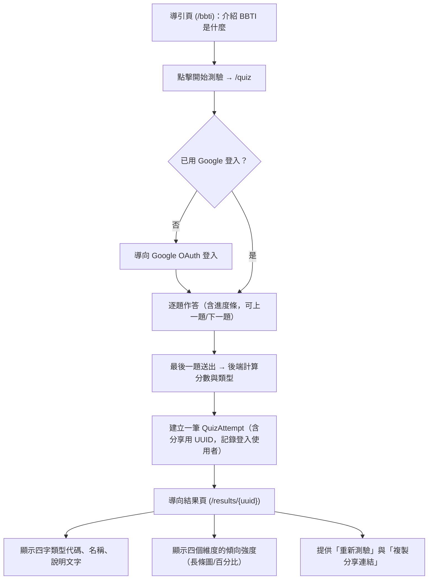
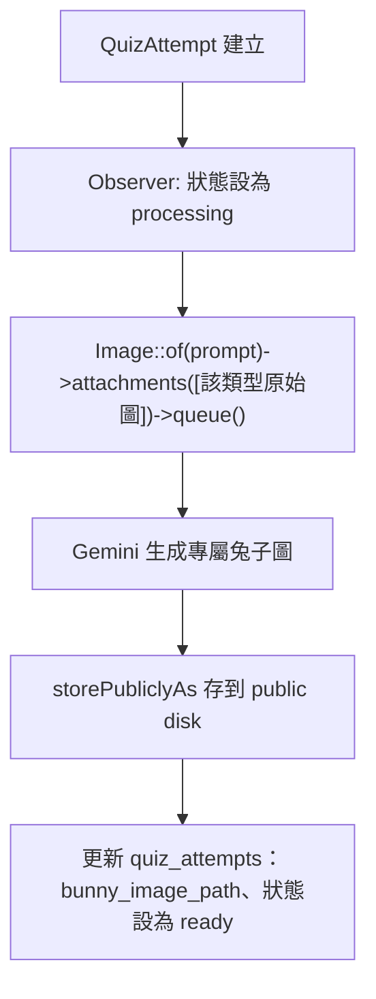

# BBTI 風格性格測驗 — 規劃書

## 1. 目標與範圍

打造一個「勾選題目 → 自動結算出性格類型」的網頁功能，玩法類似 MBTI：

- 使用者依序作答一連串題目（每題對應四個性格維度之一）
- 系統依作答結果計算出使用者落在哪一個維度極性，組合成一組四字代碼（如 `NSHG`）
- 顯示該類型的說明頁面，並可分享結果連結

技術棧：Laravel 13 + Livewire（透過 Filament 4 已內建）+ Filament 4（作為題目與類型內容的後台管理）。此文件不含程式碼，僅作為實作前的規劃依據。

### 1.1 BBTI 簡介

Bunny Builder Type Indicator (BBTI) / 創客兔性格指標

BBTI（Bunny Builder Type Indicator）是專為現代數位產品打造者設計的社群型性格指標。在這個由程式碼、設計系統、自動化工作流與 AI 共同驅動的新時代，創作者不再受限於單一職能——無論你是深耕後端架構的工程師、雕琢像素與互動的 UI/UX 設計師，還是擅長整合工具快速驗證點子的獨立創作者，只要你動手把想法變成產品，你就是聚落裡不可或缺的創作者。

---

## 2. 使用者流程



**已確認**：須先用 Google 登入才能作答，測驗結果會記錄在該使用者名下（`quiz_attempts.user_id` 對應登入者）。結果仍以 UUID7 網址存取即可分享，分享對象不需要登入就能看到別人的結果頁。**另已確認**：`/quiz` 之前加一個導引頁（路徑 `/bbti`，`/` 已保留給 GatherConf 官網），介紹 BBTI 簡介（見第 1.1 節）並提供「開始測驗」按鈕，畫面規格見 `docs/screen-design-spec.md`。

---

## 3. BBTI 性格維度與計分模型

沿用 BBTI 的四組對立維度，每組各出 N 題（初始資料為 10 題，兩極各 5 題，共 40 題，可依需求調整）：

| 維度代碼 | 正極 | 負極 |
|---|---|---|
| 探索心態 (Exploration Style) | N 新奇開拓 (Novel) | M 穩固成熟 (Matured) |
| 技術偏好 (Tech Preference) | S 系統 (System) | V 視覺 (Vision) |
| 工具哲學 (Tooling Philosophy) | H 親手介入 (Human) | A 自動化生成(Auto) |
| 聚落動態 (Village Dynamics) | G 熱情採集 (Village) | D 深入探索 (Deep) |

**作答方式**：採 5 點量表（非常不同意 1 — 非常同意 5），每題僅歸屬一個維度、並標記傾向其中一極（例如某題「傾向 S」，選 5 分即強烈偏向 S，選 1 分即強烈偏向 V）。

**計分規則**：
1. 將每題分數轉換為 -2 ~ +2（1→-2, 2→-1, 3→0, 4→+1, 5→+2）
2. 若題目標記「傾向正極」，直接加總；若標記「傾向負極」，則加總時取負號，統一轉換成「正極得分」
3. 每個維度加總後，得分 > 0 → 取正極字母；得分 < 0 → 取負極字母
4. **平手規則（得分 = 0）**：**已確認**，採方案 A，固定偏向 NM→N、SV→V、HA→A、GD→D。

計分邏輯應獨立成一個可單元測試的類別（例如 `App\Actions\ComputePersonalityType`），輸入為「題目 ID => 分數」的集合，輸出為四個維度分數 + 最終四字代碼，不與 Livewire 元件耦合。

---

## 4. 資料模型

### 4.1 `personality_types`（16 種類型的內容，Filament 後台可編輯）

| 欄位 | 型別 | 說明 |
|---|---|---|
| id | bigint | |
| code | string(4), unique | 如 `NSHG` |
| name | string | 類型暱稱，如「建築師」 |
| summary | string | 一句話摘要 |
| description | text | 完整說明 |
| strengths | json (nullable) | 優勢列表 |
| weaknesses | json (nullable) | 待成長列表 |

以 Filament Resource 管理，初始以 Seeder 匯入 16 筆固定資料。

### 4.2 `quiz_questions`（題目，Filament 後台可編輯）

| 欄位 | 型別 | 說明 |
|---|---|---|
| id | bigint | |
| axis | enum(`SV`,`NM`,`HA`,`GD`) | 所屬維度 |
| positive_pole | enum(`S`,`V`,`N`,`M`,`H`,`A`,`G`,`D`) | 選「同意」時代表哪一極 |
| text | string | 題目文字 |
| order | unsigned int | 顯示順序，供排序用 |
| is_active | boolean, default true | 下架題目不出現在測驗中 |

以 Filament Resource 管理，可拖曳排序（沿用專案內既有排序元件慣例，若無則使用 `order` 欄位 + `orderBy`）。

### 4.3 `quiz_attempts`（每次作答結果，用於結算與分享）

| 欄位 | 型別 | 說明 |
|---|---|---|
| id | bigint | |
| uuid | uuid, unique | 分享連結用識別碼 |
| user_id | FK users | **已確認**：作答須先用 Google 登入，一律記錄登入者，不再是 nullable |
| scores | json | 四維度原始分數，如 `{"SV": 6, "NM": -3, "HA": 2, "GD": -8}` |
| type_code | string(4), FK personality_types.code | 結算出的四字代碼 |
| completed_at | timestamp | |

### 4.4 `quiz_answers`（可選，逐題作答記錄，供後續數據分析）

| 欄位 | 型別 | 說明 |
|---|---|---|
| id | bigint | |
| quiz_attempt_id | FK | |
| quiz_question_id | FK | |
| value | tinyint (1-5) | 使用者原始選擇 |

> 若 MVP 階段不需要逐題分析（例如「哪一題最常選極端值」），可先省略此表，只在 `quiz_attempts.scores` 存四維度加總即可，未來再擴充。**建議先不做**，符合精簡原則，待有實際分析需求再新增。

---

## 5. Livewire 元件設計

### 5.0 導引頁（`/bbti`，靜態 Blade view，非 Livewire 元件）

不需要狀態或互動邏輯，純粹是 BBTI 簡介（沿用第 1.1 節文案）+「開始測驗」按鈕（連到 `/quiz`），用一般 Blade view 搭 `Route::view()` 即可，不必為此建立 Livewire 元件。畫面配置見 `docs/screen-design-spec.md`。

### 5.1 `App\Livewire\Quiz`（全頁元件，路由 `/quiz`，**需登入**）

- **中介層**：套用 `auth` middleware（見第 6 節路由規劃），未登入者導向 Google OAuth 登入流程（Laravel Socialite），登入完成後導回 `/quiz` 繼續作答。
- **狀態**：
  - `questions`（唯讀，載入時依 `order` 取出所有 `is_active` 題目）
  - `currentIndex`：目前題號
  - `answers`：`[question_id => value]`
- **方法**：
  - `mount()`：載入題目列表
  - `answer(int $questionId, int $value)`：記錄作答，自動前進下一題（或提供「下一題」按鈕，視 UX 決定）
  - `previous()` / `next()`：導覽題目
  - `submit()`：檢查是否全部作答完成 → 呼叫 `ComputePersonalityType` → 建立 `QuizAttempt`（`user_id` 帶入 `auth()->id()`）→ `redirect(route('quiz.result', $attempt->uuid))`
- **UI 重點**：進度條（`currentIndex / count(questions)`）、單題卡片、上一題/下一題按鈕、最後一題顯示「送出」

### 5.2 `App\Livewire\QuizResult`（全頁元件，路由 `/results/{uuid}`）

- **狀態**：依 `uuid` 從路由參數載入對應 `QuizAttempt` 與 `PersonalityType`
- **UI 重點**：
  - 四字代碼 + 類型名稱、說明
  - 四個維度的傾向強度視覺化（長條圖或百分比，正負分數轉換為 0-100% 呈現）
  - 「複製分享連結」按鈕（Alpine.js + Clipboard API）
  - 「重新測驗」按鈕連回 `/quiz`
- 找不到對應 `uuid` 時回傳 404（`findOrFail`）

---

## 6. 路由規劃

```php
// routes/web.php
Route::view('/bbti', 'bbti.intro')->name('bbti.intro');
Route::get('/quiz', Quiz::class)->middleware('auth')->name('quiz.start');
Route::get('/results/{attempt:uuid}', QuizResult::class)
    ->middleware('throttle:results')
    ->name('quiz.result');
```

`/quiz` 掛 `auth` middleware，未登入會被導向登入頁；`/results/{uuid}` 維持公開、不設過期時間，讓分享連結可以一直分享下去，但掛上依 IP 節流的 `throttle:results`（於 `RouteServiceProvider`/`bootstrap/app.php` 定義一個比預設更嚴格的 rate limiter，例如每分鐘數十次），防止有心人寫程式暴力枚舉 UUID 亂猜別人的結果。使用 Route Model Binding 綁定 `uuid` 欄位（`QuizAttempt` 需設定 `getRouteKeyName()` 回傳 `uuid`）。

**Google 登入**：使用 Laravel Socialite 的 Google Provider，需另外規劃 `GET /auth/google/redirect`、`GET /auth/google/callback` 兩支路由，callback 依 Google 回傳的 email 找到或建立對應的 `users` 資料列。這部分屬於一般身份驗證基礎建設，不是本測驗專屬邏輯，之後實作時可獨立於 `Quiz`/`QuizResult` 元件之外處理。

---

## 7. Filament 後台管理

在既有 Filament Panel 下新增兩個 Resource：

- `PersonalityTypeResource`：管理 16 種類型的名稱／說明／優缺點文字
- `QuizQuestionResource`：管理題目文字、所屬維度、正極標記、啟用狀態、排序

好處：日後調整題目或文案不需改程式碼部署，行銷/內容人員可直接在後台編輯。`quiz_attempts` 視需求也可加一個唯讀的 Resource 做簡易數據檢視（例如統計最常見的類型分布），但非 MVP 必要項目。

---

## 8. 開發步驟建議

1. 建立 migrations：`personality_types`、`quiz_questions`、`quiz_attempts`
2. 建立 Model 與關聯（`QuizAttempt belongsTo PersonalityType`、`QuizQuestion` 無關聯）
3. 撰寫 16 種類型與初始題目的 Seeder
4. 實作 `ComputePersonalityType` 計分類別 + 單元測試（覆蓋 16 種組合與平手規則）
5. 實作 `Quiz` Livewire 元件 + Feature 測試（作答流程、送出後導向結果頁）
6. 實作 `QuizResult` Livewire 元件 + Feature 測試
7. 實作 Filament Resources（題目、類型管理）
8. UI 樣式（Tailwind，沿用專案既有風格）
9. 視需求加入分享圖片/OG meta tag（分享到社群時顯示測驗結果卡片）

---

## 9. 個人化兔子圖生成（規劃中，尚未開發）

### 9.1 目標

每筆 `quiz_attempts` 建立後，自動用 AI 生成一張屬於該使用者的專屬兔子插圖，讓測驗結果頁除了文字說明，還能看到一張獨一無二的角色圖。

### 9.2 前提素材

16 種類型各自需要一張「原始兔子圖」作為參考底圖，存放在 `storage/app/private/bunny/{四字代碼}.png`（private disk，不對外公開）。**已確認**：四字代碼組字順序統一為 **NM → SV → HA → GD**（此順序是依需求調整過的規格，非隨意決定）。**目前已放入 6 張**（`NSHG.png`、`MSHG.jpeg`、`NSAG.jpeg`、`NSHD.jpeg`、`NVAG.jpeg`、`NVHG.jpeg`），其餘 10 張待補。

### 9.3 技術選型

使用 Laravel 官方套件 **`laravel/ai`**（`composer require laravel/ai`），而非自行串接 Gemini REST API。套件原生支援：

- 多 provider 圖片生成（OpenAI／Gemini／xAI），本功能指定用 Gemini
- 以 `attachments()` 傳入參考圖，做 image-to-image 微調
- `->queue()->then(...)` 佇列化生成 + 完成後回呼
- `store()`／`storePubliclyAs()` 直接存到 Laravel filesystem disk

環境變數：`.env` 新增 `GEMINI_API_KEY`（金鑰由專案維護者自行填入，不記錄在文件或對話中）。

### 9.4 觸發流程



觸發點用 Eloquent Observer（`QuizAttemptObserver`，掛在 `QuizAttempt` 的 `created` 事件），沿用專案裡 `#[Fillable(...)]` 的 attribute 慣例，改用 `#[ObservedBy(QuizAttemptObserver::class)]` 註冊，而不是在 Model 的 `booted()` 裡手動綁定。

### 9.5 資料表異動（尚未執行）

`quiz_attempts` 需新增三個欄位：

| 欄位 | 型別 | 說明 |
|---|---|---|
| bunny_image_path | string, nullable | 生成完成後的圖片路徑（public disk） |
| bunny_generation_status | enum（`App\Enums\BunnyGenerationStatus`） | `pending` / `processing` / `ready` / `failed` |
| bunny_generation_error | text, nullable | 生成失敗時的錯誤訊息 |

### 9.6 待確認事項（需在套件安裝後現場查證，非需求面決策）

1. `Image::queue()` 目前只確認有 `->then()` 完成回呼，尚未確認失敗時的回呼機制（agent 的 `queue()` 有 `->catch()`，image 是否也有還沒查到）。若沒有現成的失敗掛鉤，可能要退而改成自己包一層 Job，同步呼叫 `generate()` 並自行 try/catch。
2. `Files\Image::fromStorage()` 文件沒展示指定 disk 的參數，目前規劃能運作是因為專案預設 disk（`FILESYSTEM_DISK=local`）剛好等於原始兔子圖所在位置，這點較脆弱，需要在套件裝好後讀原始碼確認是否可以明確指定 disk。
3. `config/ai.php` 裡「圖片生成」要怎麼指定用 Gemini（`Image::of()` 本身沒有 `->provider()`/`->model()` 可在呼叫端指定，吃的是設定檔預設值），確切的設定鍵名要等套件裝好、跑過 `vendor:publish` 後才能確認。

### 9.7 驗證方式（開發時，尚無 Livewire 介面）

因為測驗作答的 Livewire 元件（`Quiz`／`QuizResult`）目前還沒開發，屆時可先用 `php artisan tinker` 手動建立一筆 `type_code = NSHG` 的 `QuizAttempt`（目前唯一有底圖的類型），跑 `php artisan queue:work --once` 讓佇列處理一次，確認 `storage/app/public/bunnies/{uuid}.png` 有產生、`bunny_generation_status` 變成 `ready`。由於每次呼叫都是真的打 Gemini API、會消耗額度，驗證跑 1–2 次確認管線通了即可，不要迴圈測試。
