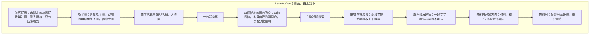

# BBTI 測驗畫面規格

本文件說明 `/bbti` 導引頁、`/quiz` 作答頁與 `/results/{uuid}` 結果頁目前的版面與行為。功能與資料見 `docs/mbti-quiz-planning.md`，色票、字體、間距、元件的共通規則以 `docs/design-system.md` 為準，本文件只補測驗頁面特有的部分。

---

## 1. 整體風格

**調性**：BBTI 是給數位產品打造者，也就是工程師、設計師與獨立創作者玩的社群性格測驗。風格親和、活潑、帶點手作感的科技感，不要太幼稚，也不要像企業後台。兔子角色是主視覺，整體排版維持像技術社群活動會用的簡潔調性。

**色彩、字體、間距**：全站共用同一套 token，見 `docs/design-system.md` 第 3 到 5 節，支援 light 與 dark，頁面一律使用 token，不直接寫色碼。測驗頁面特有的是四個維度的識別色，只用在結果頁的維度長條：

| 維度 | 識別色 Light | 識別色 Dark | token |
|---|---|---|---|
| NM 探索心態 | `#a8481f` | `#e08a5f` | `axis-nm` |
| SV 技術偏好 | `#2a6a96` | `#6fa8d6` | `axis-sv` |
| HA 工具哲學 | `#8a6212` | `#d4ad4f` | `axis-ha` |
| GD 聚落動態 | `#8b3a62` | `#d58ab0` | `axis-gd` |

四色刻意不用綠色系，避免和品牌強調色混淆，色相彼此拉開，在 light 與 dark 下色覺辨識度都在安全範圍內。找不到結果等錯誤文字使用單一警示色，不額外擴充色板。

**插畫風格**：兔子角色統一走扁平插畫路線，線條乾淨、色塊為主，16 種類型放在一起才有同一系列角色的一致感。可以帶一點程式碼、像素或工具的小元素，但不佔畫面太多空間。

**裝置優先順序**：作答頁與結果頁以手機直式畫面為優先，因為活動現場會用手機掃碼作答。桌面版只做加寬置中，不做成不同的版面。

---

## 2. `/bbti` 導引頁

靜態頁面，沒有互動狀態，作為開始測驗前的入口。`/` 保留給官網首頁。

由上到下：

1. 標題「BBTI 創客兔性格指標」與副標題「Bunny Builder Type Indicator」。
2. 簡介文字，說明這是給數位產品打造者玩的社群性格測驗。
3. 題數與預估時間，題數是每次抽出的題數，目前為 12 題。
4. 完成測驗可獲得的胡蘿蔔數量。
5. 登入提示：不用登入就能直接開始，測完可以再決定要不要註冊。
6. 會員有上一次的結果時，顯示「你上次的 BBTI 結果」卡片，含類型、完成日期與「查看完整結果」。
7. 「開始測驗」按鈕。會員有上次結果時文字改為「重新測驗」。

**重點**：
- 這頁的任務是建立第一印象、說清楚是什麼，並把使用者送去 `/quiz`，不放太多資訊，也不列出全部 16 種類型。
- 「開始測驗」是主要按鈕，不放競爭的行動，例如分享按鈕。

---

## 3. `/quiz` 作答頁

單題卡片式版面，一次只顯示一題，避免使用者被題數嚇到。

由上到下：

1. 進度區：「第 N 題，共 12 題」與進度條。
2. 題目卡片：題號、題目文字。
3. 5 點量表：非常不同意到非常同意，是 5 個單選項，手機版直向堆疊，較寬的畫面橫向排列。
4. 按鈕列：「上一題」「下一題」，最後一題改為「送出」。

**行為**：
- 每題預設選在中間的 3，沒有空答，所以「下一題」一開始就可以點。
- 進度條與題號用主強調色。
- 所有題目疊在同一格，容器高度固定為最高的那一題，換題時版面不會跳動。
- 換題後把焦點交給該題的選項，鍵盤與螢幕閱讀器使用者不會掉回頁首。
- 每題是一個 `fieldset`，題目文字與選項群組有對應的描述，螢幕閱讀器會朗讀題目。
- 沒有 JavaScript 時，12 題會全部顯示，直接送出表單，仍然可以完成測驗。
- 不在畫面上顯示這題屬於哪個維度，使用者只看到題目本身。
- 送出時有題目沒答，在頁首顯示「請回答所有題目後再送出。」，同一組題目保留，使用者已選的答案不會遺失。
- 沒有啟用的題目時，顯示「題目準備中，請稍後再來。」。

---

## 4. `/results/{uuid}` 結果頁

結果頁是整個體驗的高潮，版面比作答頁豐富。

**行為與樣式重點**：
- 兔子圖是整頁視覺焦點，尺寸要夠大、放在最上方，優先於文字代碼，強化「這是屬於我的角色」的感受。
- 專屬兔子圖還在生成時，頁面短暫等待並先顯示類型兔子圖。生成失敗或超過等待時間，就維持類型兔子圖，不能整頁空白或報錯。
- 四個維度長條使用同一種元件：長條從中線往左右延伸，正極在左、負極在右，比單純的百分比更直覺。長條下方文字顯示偏向的字母與百分比，也提供給螢幕閱讀器的說明文字。
- 每個維度的長條比例以該次測驗該維度的滿分計算，12 題的測驗四個維度的滿分一致。
- 「複製分享連結」點擊後文字短暫變成「已複製連結」，並透過 `role="status"` 的隱藏文字通知螢幕閱讀器，不讓使用者不確定有沒有複製成功。複製的內容是固定的分享文字加結果網址。
- 「重新測驗」導回 `/quiz`，視覺上是次要按鈕，避免和分享搶主要按鈕的視覺權重，分享才是社群擴散的關鍵行為。
- 訪客提示只在沒有登入會員時顯示，內容是結果未綁定、會定期清除，文字一律維持「定期清除」，實際由管理員不定期處理，提供「註冊會員並保留這份報告」與「登入會員」，註冊連結帶上結果的 UUID。
- 找不到結果的 UUID 時回傳 404。

---

## 5. Filament 後台風格

Filament 後台，包含 `PersonalityTypeResource`、`QuizQuestionResource`、`DriftBottleResource`、`AuthorizationCodeResource` 等管理畫面，維持 Filament 預設主題，不客製化配色、字體或插畫風格。後台使用者是內容與營運人員，操作效率優先於品牌調性，套用預設主題也能減少 Filament 版本更新時的維護成本。

本文件第 1 節的風格規範只適用於 `/bbti`、`/quiz` 與 `/results/{uuid}` 這三個對外畫面。
