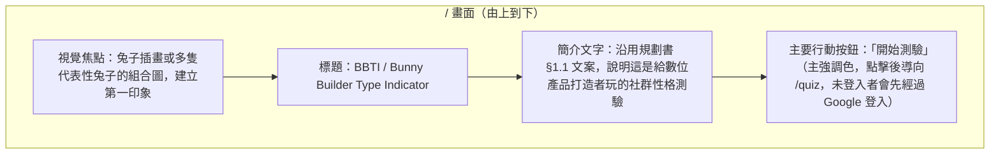
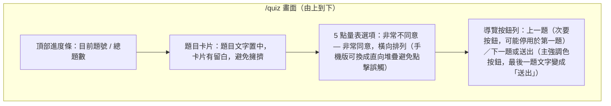
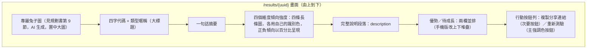

# BBTI 測驗 — 畫面設計規格

本文件規劃 `/bbti`（導引頁）、`/quiz`（作答頁）與 `/results/{uuid}`（結果頁）的大致長相與視覺風格，作為之後刻版面與樣式時的依據。不含逐 pixel 的精確設計稿，聚焦在版面結構、風格調性與元件配置邏輯。技術實作依據見 `docs/mbti-quiz-planning.md` 第 5 節。

---

## 1. 整體風格

**調性**：BBTI 是給「數位產品打造者」（工程師、設計師、獨立創作者）玩的社群性格測驗，風格應該是**親和、活潑、帶點手作感的科技感**——不要太幼稚可愛，也不要太生硬像企業後台系統。兔子角色是主視覺，但整體排版仍要維持像技術社群活動（GatherConf）會用的簡潔調性。

**色彩**：**已確認**改為大地森林色系（原暖色系方向已捨棄），色票如下。四個維度的識別色已用色彩驗證工具跑過 CVD（色覺辨識障礙）分離度、正常視覺可辨識度、對比度、彩度門檻，light／dark 兩組皆全數通過，不是隨手挑的顏色。

| 角色 | Light | Dark | 用途 |
|---|---|---|---|
| 頁面背景 | `#F5F1E8`（暖米色／羊皮紙感） | `#1C1815`（深棕黑） | 全站底色，不用純白/純黑 |
| 主要文字 | `#2B2620` | `#F3EFE6` | 內文、標題 |
| 次要文字 | `#6B6355` | `#B9B0A0` | 說明文字、輔助資訊 |
| 品牌強調色（森林綠） | `#2F6B4F` | `#4C9873` | 按鈕、進度條、連結等互動元件，全站唯一強調色 |

四個維度的識別色（僅用於結果頁的維度長條圖），對應規劃書第 3 節的維度順序（NM／SV／HA／GD）：

| 維度 | 識別色（Light） | 識別色（Dark） |
|---|---|---|
| NM 探索心態 | `#B5502E`（赤陶橘） | `#CC6C3D` |
| SV 技術偏好 | `#00897B`（深松綠藍／墨綠） | `#26A696` |
| HA 工具哲學 | `#A8790A`（赭石金） | `#B8862A` |
| GD 聚落動態 | `#8B3A62`（暗梅紫） | `#B5567F` |

四色刻意不用綠色系（避免和品牌強調色的森林綠混淆），涵蓋橘、藍綠、金、紫四個色相家族，彼此色相角度夠開，相鄰色塊在 light／dark 兩種模式下的 CVD 模擬與正常視覺辨識度都在安全範圍內。錯誤／警示類文字（例如找不到結果 404）維持用單一警示色，不額外擴充色板，且不與上述任一識別色重複。

**字體**：
- 標題／兔子類型名稱：可以用稍有個性、圓潤的字重，呼應吉祥物調性。
- 內文（題目文字、說明文字）：維持普通易讀的無襯線字體，避免整頁都用花俏字體影響閱讀速度，畢竟使用者要連續看 20 題。

**插畫風格**：兔子角色統一走扁平插畫（flat illustration）路線，線條乾淨、色塊為主，避免過度精細寫實，這樣 16 種類型放在一起才會有一致的「同一個系列角色」的感覺。可以在插畫細節裡帶一點點程式碼／像素／工具的小元素（例如兔子手上拿著筆電或扳手），呼應「打造者」主題，但不宜佔畫面太多空間喧賓奪主。

**裝置優先順序**：作答與結果頁都要以手機直式畫面為優先設計（社群活動現場用手機掃碼作答的情境），桌面版本再做加寬置中處理，不用做成完全不同的版面。

**間距**：**已確認**採 8px 網格。不需要調整 Tailwind 設定（Tailwind v4 預設刻度本身就是 4px 一階），純粹是團隊約定：畫面間距只用偶數步階——`2/4/6/8/12/16/20/24`（對應 8/16/24/32/48/64/80/96px），奇數步階（如 `gap-3`、`p-5`）不使用。手足元件間的間距一律用 `gap-*`，不要用 margin 疊加。

---

## 2. `/bbti`（導引頁）

**已確認**：`/quiz` 之前加一個導引頁，介紹 BBTI 是什麼，作為登入/開始測驗前的入口。單純的靜態頁面，沒有互動狀態（見規劃書 §5.0）。**路徑已確認為 `/bbti`**，`/` 保留給 GatherConf 官網 landing page。

**行為與樣式重點**：
- 這頁的任務單純：建立第一印象、說清楚這是什麼、然後把使用者送去 `/quiz`，不需要放太多資訊分散注意力（例如不需要在這裡列出全部 16 種類型）。
- 「開始測驗」是全頁唯一的主要按鈕，不放次要的競爭行動（例如不需要在導引頁放分享按鈕）。
- 沿用第 1 節的整體風格（扁平插畫、單一強調色），視覺上要讓使用者一眼認出跟 `/quiz`、`/results` 是同一個產品。

---

## 3. `/quiz` 作答頁

單題卡片式版面，一次只顯示一題，避免使用者被 20 題的份量嚇到。

**行為與樣式重點**：
- 進度條用主強調色，選擇某個選項後才允許進到下一題（避免空答）。
- 5 點量表用視覺化的分段控制項（例如 5 顆可點選的圓點或分段按鈕），不建議用純文字下拉選單，答題手感會太生硬。
- 卡片本身有淡入／滑動的轉場動畫，讓連續作答 20 題不會顯得死板。
- 不需要在畫面上暴露「這題屬於哪個維度」這種內部術語，使用者只看到題目本身。

---

## 4. `/results/{uuid}` 結果頁

結果頁是整個體驗的高潮，版面比作答頁更豐富、更視覺化。

**行為與樣式重點**：
- 兔子圖是整頁視覺焦點，尺寸要夠大、放在最上方，優先於文字代碼本身，強化「這是屬於我的角色」的感受。
- 若兔子圖生成中或失敗（見規劃書第 9 節的 `bunny_generation_status`），這個區塊要有替代呈現（例如用該類型的原始底圖或簡單的等待動畫），不能整頁空白或報錯。
- 四個維度長條圖用同一種視覺元件（長條或分段條），不要四個維度各用不同圖表類型，保持一致性；正負傾向可以用長條從中線往左右延伸的方式呈現兩極對比，比單純的百分比數字更直覺。
- 分享連結按鈕點擊後要有明確的「已複製」回饋（例如短暫變成打勾圖示或提示文字），不要讓使用者不確定有沒有複製成功。
- 「重新測驗」導回 `/quiz`，視覺上做成次要選項即可，避免和分享搶主要按鈕的視覺權重（分享才是社群擴散的關鍵行為）。

---

## 5. Filament 後台風格

Filament 後台（`PersonalityTypeResource`、`QuizQuestionResource` 等管理畫面）**維持 Filament 預設主題**，不客製化配色、字體或插畫風格。理由：後台使用者是內容/行銷人員而非測驗玩家，操作效率優先於品牌調性，套用預設主題也能減少維護成本（Filament 版本更新時不用同步調整客製樣式）。本文件第 1 節訂的色彩、字體、插畫風格規範只適用於 `/quiz` 與 `/results/{uuid}` 這兩個對外畫面。

